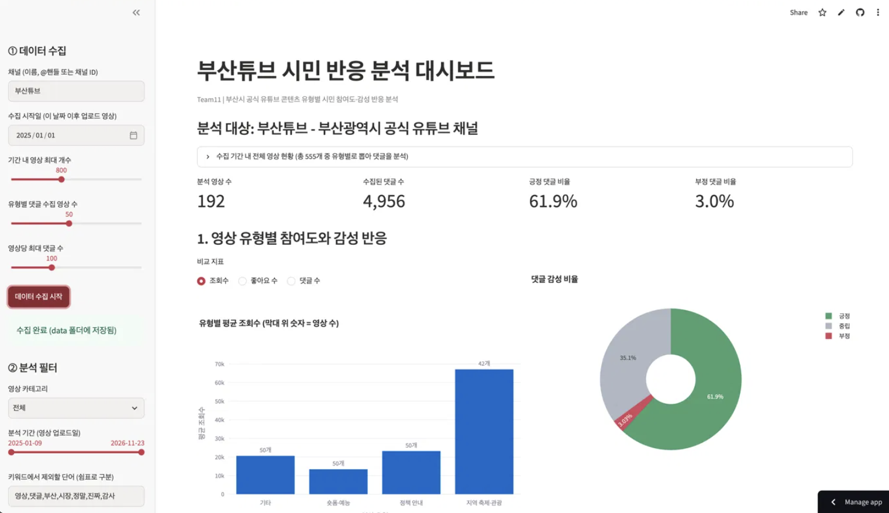
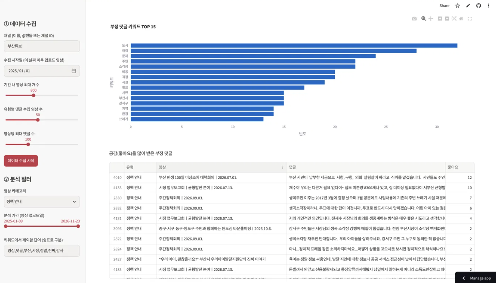

# Team11 – 부산튜브 시민 반응 분석 대시보드

> 앱 URL: https://team11-qvqdgjkayhysinnfk5lnfz.streamlit.app/

## 프로젝트 소개
부산광역시 공식 유튜브 채널(부산튜브)의 영상을 유형(정책 안내 / 지역 축제·관광 / 숏폼·예능)별로 나누어
시민 참여도(조회수·좋아요·댓글 수)와 댓글 감성 반응, 주요 키워드를 분석하는 Streamlit 대시보드입니다.

## 팀원
| 이름 | 역할 |
|---|---|
| 라유리 | 코드 구현 및 GitHub 관리 |
| 한지민 | 코드 구현 및 보고서 작성 |

## 주요 기능
- YouTube Data API v3로 영상 메타데이터·댓글 수집
- 작성자 닉네임 익명화(user_001), 댓글 속 전화번호·이메일 마스킹
- 제목·영상 길이 기반 영상 유형 자동 분류
- Kiwi 형태소 분석 기반 명사 키워드 추출, 워드클라우드·빈도 차트
- 긍정/중립/부정 사전 기반 감성 분석, 유형별 감성 비교, 카이제곱 검정
- 정책 안내와 숏폼·예능의 참여도 차이는 만위트니 U 검정으로 확인
- 
## 실행 방법
```bash
pip install -r requirements.txt
# .streamlit 폴더에 secrets.toml 파일을 만들고 YOUTUBE_API_KEY = "발급받은 키" 입력
streamlit run app.py
```
- API 키가 없어도 `data/` 폴더에 저장된 샘플 CSV가 있으면 그 데이터로 화면을 볼 수 있습니다.
- 워드클라우드의 한글 폰트는 윈도우/맥 기본 폰트를 사용하며, 없으면 `fonts/` 폴더에 .ttf 파일을 넣으세요.

## 사용 라이브러리
streamlit, pandas, plotly, google-api-python-client, kiwipiepy, wordcloud

## 개인정보 및 API 키
- 작성자 닉네임은 수집 즉시 `user_001` 형태로 바꾸고 원본은 저장하지 않습니다.
- API 키는 코드에 없고 `secrets.toml`(Git 제외)로 관리합니다.

## 한계
감성 분석은 직접 만든 단어 사전 기반이라 반어법·문맥을 반영하지 못하며, 영상 유형은 제목·길이로 자동 분류한 값입니다.

## 실행 화면
## 실행 화면

메인 대시보드



정책 안내 영상 키워드와 부정 댓글



